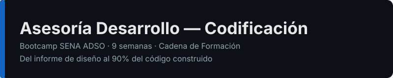

<p align="center">
  
</p>

<p align="center">
  <a href="LICENSE"></a>
  <a href="#"></a>
  <a href="#"></a>
  <a href="#"></a>
  <a href="CONTRIBUTING.md"></a>
</p>

<p align="center">
  <a href="README.md"></a>
</p>

---

## 📋 Description

A **9-week (~1 quarter)** bootcamp for the **Development Advisory — Project Coding** training
activity, aimed at chained-training apprentices (Programming Technician → ADSO Technologist)
finishing their academic stage in December.

Covers the RAP *"Plan software construction activities according to the established design"*: it
starts from the design report delivered the previous quarter (pre-project, architecture, use
cases, user stories) and takes the apprentice to **code their own real project** with
professional standards, version control and basic automation from day one.

> 📐 See [`docs/plan-curricular.md`](docs/plan-curricular.md) (Spanish) for the full traceability
> of Competency, Knowledge, Process Knowledge and Evaluation Criteria of the RAP.

### 🎯 Objectives

By the end of the bootcamp, apprentices will be able to:

- ✅ Interpret their design report to define a construction work plan
- ✅ Select and configure a complete development environment for their stack
- ✅ Define and document coding standards for the chosen stack
- ✅ Select and configure versioning tools with a collaborative workflow
- ✅ Configure basic continuous integration (lint + test on every Pull Request)
- ✅ Run 8 real sprints on their own project with weekly review
- ✅ Reach week 9 with **at least 90% of the project's code built**

### 💡 Why this bootcamp?

> **No time to waste.** Onboarding (interpreting the design, choosing the stack, setting up the
> environment, standards, Git and CI/CD) is resolved in the first half of week 1 — the second
> half is already real code on the apprentice's project.

Apprentices arrive this quarter with an approved design (pre-project, architecture, use cases,
user stories from the previous quarter). The goal isn't teaching to code from scratch — it's
installing the engineering discipline (standards, versioning, sprints, CI) that turns that design
into real software, leaving the project at 90% progress so next quarter only needs to close
coding, documentation and deployment.

**No single stack is imposed.** Each team brings its own project and picks its stack in week 1
based on what its design needs. `proyecto-be_fastapi-fe_react` is used as a best-practices
reference (naming, linters, `be/`/`fe/` structure) — not as a mandatory stack.

---

## 🗓️ Bootcamp Structure

| Phase | Week | Hours | Focus |
| :---: | :---: | :---: | --- |
| **Fast-tracked onboarding** | 1 (1st half) | 5h | Design, stack, environment, standards, Git, CI/CD |
| **Coding kickoff** | 1 (2nd half) | 5h | Sprint 0 — first commit, first feature, first green PR |
| **Sprint execution** | 2-9 | 80h | Sprints 1 to 8, one per week, with weekly Sprint Review |

**Total: 9 weeks** | **90 hours** of training (10h/week: 6h guided classroom + 4h autonomous work)

---

## 📚 Content per Week

Each week includes:

```
bootcamp/
└── week-XX-main_topic/
    ├── README.md                # Description and objectives
    ├── rubrica-evaluacion.md    # Evaluation criteria (mapped to the RAP)
    ├── 0-assets/                # Images and diagrams
    ├── 1-teoria/                # Theory and process material
    ├── 2-practicas/             # Checklists and guided workshops
    ├── 3-proyecto/              # Deliverable applied to the team's real project
    ├── 4-recursos/              # Additional resources
    │   ├── ebooks-free/
    │   ├── videografia/
    │   └── webgrafia/
    └── 5-glosario/              # Key terms
```

### 🔑 Key Components

- 📖 **Theory**: Concepts and process, applicable to any stack
- 💻 **Practices**: Configuration and best-practices checklists
- 🚀 **Project**: Weekly deliverable on the team's real project (backlog, sprint, PRs)
- 🎓 **Resources**: Glossary and complementary material per week

---

## 🛠️ Bootcamp Tools

| Tool | Use | Cost |
| --- | --- | :---: |
| Git + GitHub | Version control, branches, Pull Requests | Free |
| GitHub Projects | Backlog, sprints and kanban board linked to the repo | Free |
| GitHub Actions | Continuous integration (lint + test on every PR) | Free |
| IDE (VS Code recommended) | Development, linter/formatter extensions | Free |
| Chosen stack runtime (Node, Python, etc.) | Local project execution | Free |
| Chosen database engine (PostgreSQL, MySQL, MongoDB, etc.) | Project persistence | Free |
| Jira / ClickUp | Alternatives to GitHub Projects, if the team already uses them | Free (free tier) |

---

## 🚀 Quick Start

### Prerequisites

- **Git** for version control
- **VS Code** (recommended) with included extensions
- Active **GitHub** account
- Previous quarter's design report (pre-project, architecture, use cases, user stories)

### 1. Clone the Repository

```bash
git clone https://github.com/ergrato-dev/bc-asesoria-proyecto.git
cd bc-asesoria-proyecto
```

### 2. Install VS Code Extensions

```bash
code .
# Recommended extensions will appear automatically
```

### 3. Start with Week 1

```bash
cd bootcamp/week-01-alistamiento_acelerado_y_arranque
```

### 4. Follow the Instructions

Each week contains a `README.md` with detailed instructions.

---

## 📊 Learning Methodology

### Teaching Strategies

- 🎯 **Project-Based Learning (PBL)**: each team's real project is the throughline, from week 1
- 🌀 **Scrum**: backlog, weekly sprints, roles (Scrum Master, PO, Dev, QA), daily/review/retro
- 🧩 **Incremental construction**: every sprint adds verifiable working code, not just documentation
- 👥 **Sprint Review with instructor**: weekly follow-up of real progress against the backlog
- 🔀 **Trunk-based collaborative flow**: `feature/*` off `develop`, `develop` → `main` at checkpoints — see [`docs/git-workflow.md`](docs/git-workflow.md)

### Time Distribution (10h/week)

- **Guided classroom (6h)**: short theory, guided checklists, Sprint Review with instructor
- **Autonomous work (4h)**: coding the real project, between classroom sessions

### Evaluation

Each week includes three types of evidence:

1. **Knowledge 🧠** (30%): Quizzes and checklists on key concepts
2. **Performance 💪** (40%): Setting up and applying best practices (Git, standards, CI/CD, Scrum ceremonies)
3. **Product 📦** (30%): Code deliverable applied to the team's real project, mapped to a RAP evaluation criterion

**Passing criterion**: Minimum 70% on each type of evidence. See [`docs/plan-curricular.md`](docs/plan-curricular.md) for full traceability.

---

## 🤝 Contributing

Contributions are welcome! This is an open-source educational project.

### How to Contribute

1. Read the [Contributing Guide](CONTRIBUTING.md)
2. Review the [Code of Conduct](CODE_OF_CONDUCT.md)
3. Fork the repository
4. Create your branch (`git checkout -b feature/new-feature`)
5. Commit with [Conventional Commits](https://www.conventionalcommits.org/) (`git commit -m 'feat: add new checklist'`)
6. Push to the branch (`git push origin feature/new-feature`)
7. Open a Pull Request

---

## 📞 Support

- 💬 **Discussions**: [GitHub Discussions](https://github.com/ergrato-dev/bc-asesoria-proyecto/discussions)
- 🐛 **Issues**: [GitHub Issues](https://github.com/ergrato-dev/bc-asesoria-proyecto/issues)

---

## ⚠️ Disclaimer

This repository is an **educational** resource created for learning purposes.

- **Educational purposes only**: content, examples and projects are designed exclusively for teaching and learning.
- **No warranties**: material is provided **"as is"**, with no warranties of any kind.
- **No real data**: no template should ever be filled with real personal data of apprentices, instructors or third parties — always use synthetic data in tests and examples.
- **Apprentice responsibility**: each team is responsible for its own code, technical decisions and compliance with the RAP evaluation criteria.

---

## 📄 License

This project is under the MIT License - see the [LICENSE](LICENSE) file for details.

---

## 📚 Additional Documentation

- [🤖 Copilot Instructions](.github/copilot-instructions.md)
- [🤝 Contributing Guide](CONTRIBUTING.md)
- [📜 Code of Conduct](CODE_OF_CONDUCT.md)
- [🔒 Security Policy](SECURITY.md)
- [📐 Curricular Plan & RAP Traceability](docs/plan-curricular.md) (Spanish)

---

<p align="center">
  <strong>🎓 Bootcamp Development Advisory — Project Coding</strong><br>
  <em>From the design report to 90% of the code built</em>
</p>

<p align="center">
  Made with ❤️ for the SENA apprentice community
</p>
