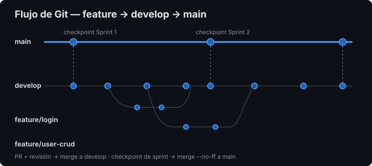

# Control de Versiones: Git y Flujo Colaborativo

## 🎯 Objetivos

- Configurar el repositorio con el flujo `feature/* → develop → main`
- Aplicar Conventional Commits desde el primer commit

## 📋 Contenido

### 1. Por qué no basta con `main` (Criterio RAP-4)

Con un solo equipo trabajando directo sobre `main`, cualquier código a medio terminar rompe lo
que los demás necesitan. El flujo con `develop` da un punto de integración estable, protegido
por CI, antes de tocar la rama que representa el estado demostrable del proyecto.

### 2. El flujo en una imagen



Detalle completo, comandos y errores comunes en [`docs/git-workflow.md`](../../../docs/git-workflow.md).

### 3. Conventional Commits

```
<tipo>(<alcance>): <descripción en inglés, imperativo>
```

`feat`, `fix`, `docs`, `style`, `refactor`, `test`, `chore`, `ci`, `perf` — tabla completa en
`docs/git-workflow.md`.

### 4. Aplicación al proyecto real

<!-- 📝 Instrucción: ejecutar en equipo sobre el repositorio real -->

```bash
git init
git checkout -b develop
git remote add origin https://github.com/<org>/<proyecto>.git
git push -u origin develop
```

- [ ] Rama `develop` creada y pusheada
- [ ] Branch protection activa en `main` y `develop` (require PR + CI)
- [ ] Al menos una `feature/*` creada desde `develop`, con un commit siguiendo Conventional Commits

## 📚 Recursos Adicionales

Ver `5-glosario/README.md` para términos de Git usados esta semana.
