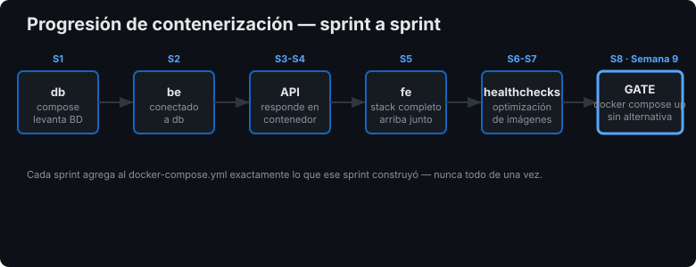

# Contenerización Gradual con Docker

## 🎯 Objetivos

- Instalar Docker y Docker Compose
- Entender por qué la contenerización crece sprint a sprint, y por qué es obligatoria sin alternativa

## 📋 Contenido

### 1. Docker no es opcional en este bootcamp

A diferencia del lenguaje, framework o base de datos —decisiones abiertas del equipo—, Docker es
la única herramienta de contenerización aceptada. El entregable del 90% de avance en la semana 9
**debe** levantar completo con `docker compose up`. No hay alternativa a esto.

### 2. Por qué gradual, no todo de una vez



Dockerizar el proyecto completo esta semana, antes de tener código, sería trabajo desechable.
Cada sprint agrega al `docker-compose.yml` exactamente lo que ese sprint construyó — ver la
progresión completa semana a semana en [`docs/docker-guia.md`](../../../docs/docker-guia.md).

### 3. Qué se hace esta semana (y qué NO)

- ✅ Instalar Docker Desktop / Docker Engine + Docker Compose
- ✅ Verificar `docker --version` y `docker compose version`
- ✅ Crear un `Dockerfile` esqueleto en `be/` y `fe/` (aún no funcional — solo la base de imagen)
- ❌ NO se arma el `docker-compose.yml` completo esta semana — la base de datos se dockeriza en el Sprint 1 (semana 2)

### 4. Aplicación al proyecto real

<!-- 📝 Instrucción: verificar instalación, crear los Dockerfile esqueleto -->

```dockerfile
# be/Dockerfile — esqueleto, se completa en sprints siguientes
FROM python:3.12-slim   # o la imagen base del runtime elegido
WORKDIR /app
# Las capas de dependencias y código llegan en el Sprint 1+
```

- [ ] `docker --version` y `docker compose version` corren en la máquina de cada integrante
- [ ] `Dockerfile` esqueleto creado en `be/` y `fe/`
- [ ] El equipo entiende la tabla de progresión de `docs/docker-guia.md` — sabe qué se dockeriza en qué sprint

## 📚 Recursos Adicionales

Ver [`docs/docker-guia.md`](../../../docs/docker-guia.md) para la guía completa de contenerización.
