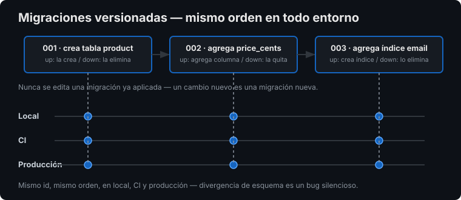
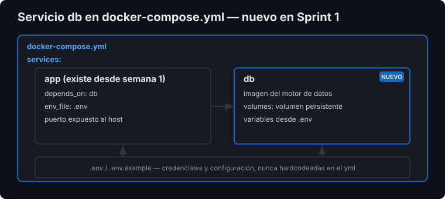

# Esquema de Datos y Migraciones

## 🎯 Objetivos

- Traducir el modelo de dominio (`01-modelado-de-dominio.md`) a un esquema de base de datos
- Escribir migraciones versionadas, reproducibles y reversibles
- Levantar el servicio `db` en `docker-compose.yml` con volumen persistente

## 📋 Contenido

### 1. Del modelo de dominio al esquema

Cada entidad suele traducirse a una tabla (relacional) o colección (documental); cada value
object se traduce a columnas embebidas o a un tipo compuesto, no a una tabla propia salvo que el
motor lo requiera. La traducción no es mecánica al 100% — el esquema optimiza para consultas y
consistencia, el modelo de dominio optimiza para expresar reglas de negocio.

### 2. Reglas mínimas de diseño de esquema

- Toda tabla tiene una clave primaria explícita — nunca depender del orden de inserción
- Toda relación `1:N` se modela con clave foránea en el lado "muchos"
- Nombres de tablas y columnas siguen `CODING_STANDARDS.md` del proyecto (definido en semana 1) — no hay excepción para la base de datos
- Tipos de datos ajustados al dominio real (no todo es `VARCHAR(255)` o `String` genérico): fechas como fecha, dinero con precisión fija, booleanos como booleanos

### 3. Migraciones: por qué versionadas y no `CREATE TABLE` manual

Una migración es un cambio de esquema versionado, aplicable en cualquier entorno (local, CI,
producción) en el mismo orden. Sin migraciones, el esquema de cada integrante del equipo diverge
en silencio. Cada migración debe:

- Tener una operación de "subir" (`up`) y, cuando el motor lo soporte, una de "bajar" (`down`)
- Ser pequeña — un cambio conceptual por migración, no todo el esquema del sprint en una sola
- Aplicarse desde cero en un entorno limpio sin intervención manual



```python
# Ejemplo ilustrativo — adapta a tu ORM/stack (Alembic, Prisma Migrate, Django migrations,
# Flyway, knex, etc. tienen su propia sintaxis; la estructura conceptual es la misma)

def upgrade():
    op.create_table(
        "product",
        sa.Column("id", sa.Integer, primary_key=True),
        sa.Column("name", sa.String(120), nullable=False),
        sa.Column("price_cents", sa.Integer, nullable=False),
        sa.Column("created_at", sa.DateTime, server_default=sa.func.now()),
    )

def downgrade():
    op.drop_table("product")
```

### 4. El servicio `db` en `docker-compose.yml`

Esta semana el `docker-compose.yml` crece con un servicio `db`, con volumen persistente para que
los datos sobrevivan a `docker compose down` (sin `-v`). No es gate bloqueante todavía — ver
[`docs/docker-guia.md`](../../../docs/docker-guia.md) — pero sí evidencia verificable de
Desempeño: `docker compose up db` debe levantar la base de datos sin errores.



```yaml
# Ejemplo ilustrativo — ajusta imagen, versión y variables a tu motor real (Postgres, MySQL, Mongo...)
services:
  db:
    image: postgres:16
    environment:
      POSTGRES_DB: ${DB_NAME}
      POSTGRES_USER: ${DB_USER}
      POSTGRES_PASSWORD: ${DB_PASSWORD}
    volumes:
      - db_data:/var/lib/postgresql/data
    ports:
      - "5432:5432"

volumes:
  db_data:
```

### 5. Aplicación al proyecto real

<!-- 📝 Instrucción: completar en equipo -->

- [ ] Esquema de datos derivado del modelo de dominio de esta semana
- [ ] Migraciones escritas, aplicables desde una base de datos vacía
- [ ] Servicio `db` en `docker-compose.yml`, con volumen persistente, verificado por todo el equipo
- [ ] Variables de conexión en `.env` / `.env.example`, nunca hardcodeadas

## 📚 Recursos Adicionales

Ver `4-recursos/webgrafia/README.md` para documentación de migraciones por ORM/framework.
