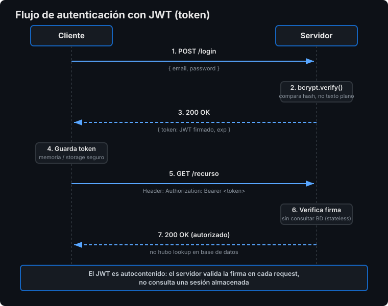

# Modelos de Autenticación y Autorización

## 🎯 Objetivos

- Distinguir **autenticación** (quién eres) de **autorización** (qué puedes hacer)
- Comparar sesión con cookie vs token (JWT) y elegir un modelo para el proyecto real
- Aplicar hashing seguro de contraseñas y control de acceso basado en roles (RBAC)

## 📋 Contenido

### 1. Autenticación vs autorización

Son dos problemas distintos que suelen confundirse:

| | Autenticación | Autorización |
|---|---|---|
| Pregunta que responde | ¿Quién eres? | ¿Qué puedes hacer? |
| Cuándo ocurre | Login | En cada request, después del login |
| Fallo típico | Credenciales inválidas (401) | Rol insuficiente (403) |

Al interpretar el backlog de este sprint (RAP-1), separa las historias de usuario en estos dos
grupos — una historia de "login" no es lo mismo que una de "solo el admin puede eliminar
usuarios", aunque ambas dependan de la misma capa de identidad.

### 2. Sesión con cookie vs Token (JWT)

| | Sesión (server-side) | Token (JWT) |
|---|---|---|
| Estado | Vive en el servidor (memoria/BD/Redis) | Autocontenido, el servidor no guarda estado |
| Escalabilidad horizontal | Requiere store compartido | Natural, sin store compartido |
| Revocar antes de expirar | Trivial (borrar del store) | Requiere lista de revocación o token corto + refresh |
| Tamaño en cada request | Solo el ID de sesión (cookie) | Todo el payload viaja en cada request |
| Caso típico | App monolítica, mismo dominio | API consumida por SPA/móvil, múltiples clientes |

Ninguno es "mejor" en abstracto — depende del stack y de si el backend ya sirve una SPA separada
o renderiza vistas. Decide uno para el proyecto real y documenta por qué en el entregable de esta
semana.



### 3. Hashing de contraseñas

Una contraseña **nunca** se guarda en texto plano ni con un hash reversible o rápido (MD5,
SHA-256 solo). Se usa un algoritmo diseñado para ser lento y resistente a fuerza bruta: **bcrypt**
o **argon2**, con *salt* automático incluido en el hash resultante.

```text
# Código ilustrativo — el algoritmo importa, la librería exacta depende de tu stack
hash = bcrypt.hash(password, cost_factor=12)
bcrypt.verify(password_ingresada, hash_guardado)  # true/false, nunca comparar strings directo
```

- ✅ El *cost factor* se ajusta para que el hash tarde ~100-300ms — suficientemente lento contra
  fuerza bruta, suficientemente rápido para no frustrar el login
- ❌ Nunca compares la contraseña ingresada contra el hash con `==` manual sobre el texto plano

### 4. Autorización basada en roles (RBAC)

Modelo mínimo: cada usuario tiene uno o más **roles**, cada acción protegida exige un rol mínimo.

```text
# Código ilustrativo — la forma exacta (decorator, middleware, guard) depende del framework
function requireRole(role):
    if usuario_actual.rol not in allowed_roles_para(role):
        return 403 Forbidden
    continue
```

No sobre-diseñes: si el backlog solo distingue `admin` vs `usuario`, no construyas un sistema de
permisos granulares que nadie pidió. RBAC simple primero, permisos finos solo si una historia de
usuario real lo exige.

### 5. Aplicación al proyecto real

<!-- 📝 Instrucción: decidir en equipo antes de codificar -->

- [ ] Modelo elegido: sesión o JWT — documentado con la razón en el Sprint Review
- [ ] Librería de hashing (bcrypt/argon2 o equivalente del stack) instalada y probada
- [ ] Tabla de roles del proyecto definida (mínimo: qué rol puede hacer qué)
- [ ] Ningún endpoint protegido responde antes de validar el rol

## 📚 Recursos Adicionales

Ver [`4-recursos/webgrafia/README.md`](../4-recursos/webgrafia/README.md) para las guías OWASP de
autenticación y la especificación de JWT.
