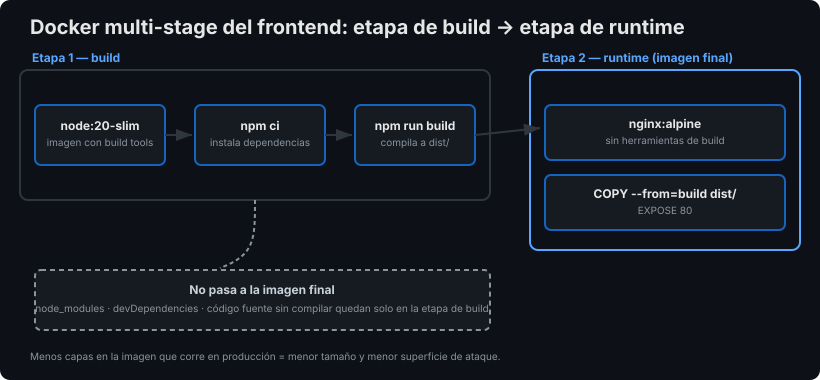

# Docker Multi-Stage para el Frontend

## 🎯 Objetivos

- Entender por qué el `Dockerfile` del frontend necesita al menos dos etapas
- Levantar backend, frontend y base de datos juntos con `docker compose up` por primera vez

## 📋 Contenido

### 1. El hito Docker de esta semana

Según la progresión de [`docs/docker-guia.md`](../../../docs/docker-guia.md), hasta la semana 5
solo el backend estaba dockerizado. Esta semana el frontend se dockeriza también, y
`docker compose up` debe levantar **los tres servicios juntos** por primera vez: `db`, `be`, `fe`.

### 2. Por qué multi-stage y no una sola etapa

Un frontend típico necesita herramientas de build (bundler, dependencias de desarrollo) que
**no** deben terminar en la imagen que corre en producción — aumentan el tamaño y la superficie
de ataque sin aportar nada en runtime. El patrón multi-stage separa:

- **Etapa de build**: instala dependencias, compila los archivos estáticos
- **Etapa de runtime**: copia solo el resultado compilado a un servidor estático/Nginx, sin las herramientas de build



### 3. Ejemplo ilustrativo (⚠️ no es código a copiar tal cual)

<!-- ⚠️ ILUSTRATIVO: nombres de comandos genéricos. Adaptar al framework de frontend real
     (el comando de build y la carpeta de salida cambian según la herramienta elegida). -->

```dockerfile
# ⚠️ Dockerfile ilustrativo — adaptar imagen base, comando de build y carpeta de salida al stack real

# Etapa 1: build
FROM node:20-slim AS build
WORKDIR /app
COPY package*.json ./
RUN npm ci
COPY . .
RUN npm run build

# Etapa 2: runtime — solo el resultado compilado, sin herramientas de build
FROM nginx:alpine
COPY --from=build /app/dist /usr/share/nginx/html
EXPOSE 80
```

### 4. Variables de entorno del frontend en Docker

La URL de la API (ver `01-consumo-api-frontend.md`) se documenta en `fe/.env.example` y se pasa
al contenedor desde `docker-compose.yml`, nunca hardcodeada dentro del `Dockerfile`.

### 5. Aplicación al proyecto real

<!-- 📝 Instrucción: ejecutar en equipo sobre el repositorio real -->

- [ ] `fe/Dockerfile` tiene al menos dos etapas (build y runtime)
- [ ] La imagen final no incluye dependencias de desarrollo ni el código fuente sin compilar
- [ ] `fe/.env.example` documenta la variable de la URL de la API
- [ ] `docker-compose.yml` agrega el servicio `fe`, conectado a `be` por la red interna de compose
- [ ] `docker compose up` en un clon limpio levanta `db`, `be` y `fe` juntos, sin pasos manuales

## 📚 Recursos Adicionales

Ver [`docs/docker-guia.md`](../../../docs/docker-guia.md) para la progresión completa y la
estructura esperada del proyecto desde esta semana.
