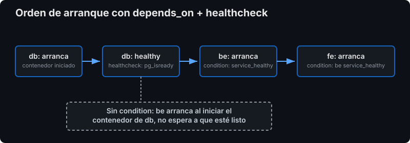

# `depends_on` con Condición y Healthchecks en Docker Compose

## 🎯 Objetivos

- Configurar `depends_on` con condición para evitar errores de orden de arranque
- Definir healthchecks para los servicios del `docker-compose.yml`

## 📋 Contenido

### 1. El problema: `depends_on` simple no espera a que el servicio esté listo

Desde la semana 6, `docker compose up` levanta backend, frontend y base de datos juntos. Pero un
`depends_on` sin condición solo espera a que el contenedor **arranque**, no a que el servicio
esté **listo para recibir conexiones**. Resultado típico: el backend arranca antes de que
PostgreSQL termine de inicializar y falla al primer intento de conexión — un error de timing, no
de lógica.

### 2. Healthcheck: cómo declarar cuándo un servicio está "listo"

```yaml
services:
  db:
    image: postgres:16
    healthcheck:
      test: ["CMD-SHELL", "pg_isready -U ${DB_USER}"]
      interval: 5s
      timeout: 3s
      retries: 5

  be:
    build: ./be
    depends_on:
      db:
        condition: service_healthy   # espera a que db pase su healthcheck, no solo a que inicie
    healthcheck:
      test: ["CMD", "curl", "-f", "http://localhost:8000/health"]
      interval: 10s
      timeout: 3s
      retries: 5

  fe:
    build: ./fe
    depends_on:
      be:
        condition: service_healthy
```

Cada servicio expone (o simula) un endpoint/verificación de salud, y el que depende de él espera
a `service_healthy`, no a `service_started`.



### 3. Red interna: por qué aislar los servicios

Con varios servicios corriendo juntos, no todos necesitan estar expuestos al host. La base de
datos, por ejemplo, solo necesita ser alcanzable por el backend dentro de la red de Compose — no
por fuera del contenedor. Exponer solo los puertos que el equipo o el navegador realmente
necesitan reduce superficie de error y de configuración.

### 4. Aplicación al proyecto real

<!-- 📝 Instrucción: agregar healthcheck y depends_on con condición a cada servicio del docker-compose.yml -->

- [ ] Healthcheck definido para `db`, `be` y `fe` (o los servicios que tenga el proyecto)
- [ ] `depends_on` de cada servicio usa `condition: service_healthy`, no la forma simple
- [ ] `docker compose up` en un clon limpio levanta todo sin errores de orden de arranque
- [ ] Solo los puertos necesarios están expuestos al host

## 📚 Recursos Adicionales

Progresión completa de contenerización en
[`docs/docker-guia.md`](../../../docs/docker-guia.md). Ver `5-glosario/README.md` para los
términos usados esta semana.
