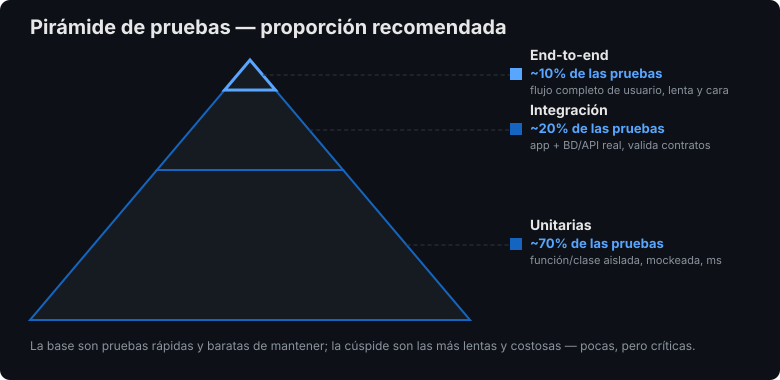

# 🧪 Pruebas y Manejo de Errores

## Unitarias vs. Integración

| | Prueba unitaria | Prueba de integración |
|---|---|---|
| **Qué verifica** | Una función/método/clase aislada | Varias piezas trabajando juntas (app + BD, app + API externa) |
| **Dependencias** | Mockeadas o inexistentes | Reales (o lo más cercano a reales: BD de prueba, contenedor) |
| **Velocidad** | Muy rápida (ms) | Más lenta (segundos) |
| **Qué detecta** | Lógica interna rota | Contratos rotos entre componentes |

Ninguna reemplaza a la otra. Una función de cálculo de precios necesita pruebas unitarias; el
endpoint que la expone y toca la base de datos necesita al menos una prueba de integración que
confirme que la cadena completa funciona.



La proporción no es arbitraria: las pruebas unitarias son baratas de escribir y correr, así que
son la base. Las de integración y end-to-end crecen en costo y lentitud a medida que suben en la
pirámide — por eso hay muchas menos.

---

## Priorizar con Tiempo Limitado

Con una semana de sprint, no alcanza (ni tiene sentido) perseguir 100% de cobertura. Prioriza así:

1. **Flujos críticos primero** — los que rompen la operación del proyecto si fallan: autenticación,
   creación/edición de la entidad principal del dominio, cualquier flujo con dinero o datos
   sensibles.
2. **Caso feliz de cada flujo crítico** — el camino esperado funciona.
3. **1-2 casos límite por flujo crítico** — entrada vacía, dato duplicado, recurso inexistente,
   usuario sin permiso. No necesitas cubrir cada combinación posible, sí los límites más probables.
4. **El resto del backlog de pruebas queda documentado como deuda técnica**, no se descarta —
   se anota en un issue para la semana 9 o se acepta conscientemente si el tiempo no alcanza.

> El taller de esta semana (`2-practicas/01-taller-cobertura-de-pruebas-criticas/`) guía al equipo
> a identificar esos 5 flujos críticos del proyecto real.

---

## Manejo Consistente de Errores en la API

Un error mal manejado (un `500` genérico, un stack trace expuesto al cliente, un mensaje distinto
en cada endpoint) es una falla de experiencia tan real como una funcionalidad faltante. El
objetivo es que **toda** la API responda errores con la misma forma.

Patrón mínimo recomendado:

- Código HTTP correcto según el tipo de error (`400` datos inválidos, `401` sin autenticar,
  `403` sin permiso, `404` recurso inexistente, `422` validación de negocio, `500` solo para
  errores no anticipados).
- Cuerpo de respuesta con la misma forma en todos los endpoints (ej. `{ "error": { "code": "...", "message": "..." } }`).
- Nunca exponer detalles internos (stack trace, query SQL) en la respuesta al cliente — sí en el
  log del servidor.

**Ejemplo ilustrativo** (pseudocódigo, agnóstico de framework — adapta al stack real del equipo):

```python
# ⚠️ Ilustrativo: adapta a tu framework/stack real, no copiar tal cual

class NotFoundError(Exception):
    def __init__(self, resource: str):
        self.resource = resource

@app.exception_handler(NotFoundError)
def handle_not_found(request, exc: NotFoundError):
    return json_response(
        status=404,
        body={"error": {"code": "not_found", "message": f"{exc.resource} no encontrado"}},
    )

@app.exception_handler(Exception)
def handle_unexpected(request, exc: Exception):
    log.error("unhandled_exception", exc_info=exc)  # detalle completo solo en el log
    return json_response(
        status=500,
        body={"error": {"code": "internal_error", "message": "Error interno del servidor"}},
    )
```

La idea central no es el código exacto — es tener **un solo lugar** que decide el formato de
error, en vez de que cada endpoint construya su propia respuesta de error a mano.

---

## Relación con RAP-3

El manejo de errores y las pruebas no son solo funcionalidad nueva: son la evidencia más directa
de que los estándares de codificación definidos en la semana 1 (`CODING_STANDARDS.md`) se aplican
en código real, verificados en el code review guiado de esta semana.
