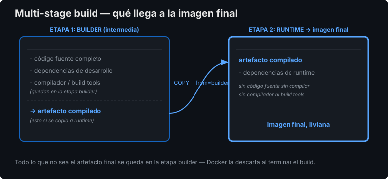

# 🐳 Optimización de Imágenes Docker

> Progresión completa de contenerización del bootcamp en [`docs/docker-guia.md`](../../../docs/docker-guia.md).
> Este archivo cubre solo lo que le corresponde a esta semana: imágenes optimizadas.

## Qué le toca a la Semana 8

Según la tabla de progresión de [`docker-guia.md`](../../../docs/docker-guia.md#progresión-por-semana),
esta semana el `Dockerfile` deja de ser "funcional" para ser **optimizado**: build multi-stage,
`.dockerignore`, y CI corriendo las pruebas contra la imagen real — no contra el entorno del
runner sin contenedor.

Esto no es opcional ni cosmético: la semana 9 es el gate de entrega. Llegar ahí con imágenes
pesadas o mal construidas es descubrir el problema demasiado tarde.

---

## Multi-Stage Build

Un `Dockerfile` de una sola etapa suele arrastrar a la imagen final las herramientas de build
(compiladores, gestores de paquetes de desarrollo) que no se necesitan en producción. Un
**multi-stage build** separa "con qué se construye" de "qué se ejecuta":

```dockerfile
# ⚠️ Ilustrativo — adapta el runtime/gestor de paquetes al stack real del proyecto

# --- Etapa 1: build ---
FROM node:24-slim AS builder
WORKDIR /app
COPY package.json pnpm-lock.yaml ./
RUN corepack enable && pnpm install --frozen-lockfile
COPY . .
RUN pnpm build

# --- Etapa 2: runtime (imagen final) ---
FROM node:24-slim AS runtime
WORKDIR /app
COPY --from=builder /app/dist ./dist
COPY --from=builder /app/package.json ./
RUN corepack enable && pnpm install --prod --frozen-lockfile
CMD ["node", "dist/main.js"]
```

Solo la última etapa (`runtime`) pasa a la imagen final. El compilador, las dependencias de
desarrollo y el código fuente sin transpilar de la etapa `builder` no viajan con ella.



---

## `.dockerignore`

Igual que `.gitignore`, pero para el contexto que Docker envía al motor de build. Sin él, cada
`docker build` copia (y a veces cachea) archivos que no deberían entrar nunca a la imagen:

```
# .dockerignore — ejemplo, ajusta a tu stack
.git
node_modules
__pycache__
*.pyc
.env
.venv
dist
coverage
*.log
```

Beneficio directo: builds más rápidos (menos contexto que transferir) e imágenes que no filtran
`.env` ni credenciales por accidente dentro de una capa.

---

## CI Contra Imágenes Reales

Hasta ahora el CI (ver [`docs/ci-cd-guia.md`](../../../docs/ci-cd-guia.md)) probablemente corría
lint y test directo sobre el runner de GitHub Actions. Esta semana, el paso siguiente es que el
workflow **construya la imagen y corra las pruebas dentro de ella** (o al menos contra un
contenedor levantado desde esa imagen), para detectar diferencias entre "funciona en mi máquina"
y "funciona en el contenedor" antes de la semana 9.

```yaml
# fragmento ilustrativo, agnóstico de stack — añade al job existente de ci.yml
- name: Build image
  run: docker build -t proyecto-be:ci ./be
- name: Run tests inside the container
  run: docker run --rm proyecto-be:ci pytest   # o el test runner real del stack
```

---

## Checklist de esta Semana

- [ ] `Dockerfile` de backend y/o frontend usa al menos dos etapas (`build` → `runtime`)
- [ ] La imagen final no incluye compiladores, dependencias de desarrollo ni código fuente sin compilar
- [ ] `.dockerignore` existe y excluye `.git`, dependencias instaladas, `.env`, artefactos de build
- [ ] El workflow de CI construye y prueba contra la imagen real, no solo en el runner desnudo
