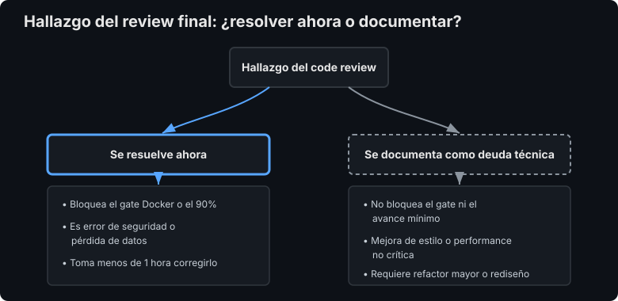

# Code Review Final y Deuda Técnica

## 🎯 Objetivos

- Ejecutar un barrido de code review sobre todo el repositorio, no solo sobre el Sprint 7
- Distinguir deuda técnica que se resuelve ahora de deuda técnica que se documenta para el siguiente trimestre
- Dejar un registro de deuda técnica útil para quien continúe el proyecto

## 📋 Contenido

### 1. Por qué el review final es distinto a los de cada PR

Cada PR de las semanas 2-8 tuvo su propio code review, acotado a esa historia de usuario. El
review de esta semana es diferente: mira el repositorio completo, de punta a punta, buscando
inconsistencias que solo aparecen cuando el código de varios sprints convive junto — nombres que
divergieron entre módulos, patrones que cambiaron a mitad de camino, capas que ya no reflejan la
arquitectura real.

### 2. Qué cubre el barrido completo

- **Consistencia con `CODING_STANDARDS.md`**: ¿el código de los primeros sprints sigue el mismo estándar que el de los últimos?
- **Estructura de carpetas**: ¿`be/`/`fe/` (o equivalente) sigue siendo coherente con lo que el proyecto terminó siendo?
- **Código muerto**: endpoints, componentes o funciones que quedaron de una decisión de diseño anterior y ya no se usan
- **Duplicación entre sprints**: lógica repetida que en su momento no se refactorizó por falta de tiempo
- **Cobertura de pruebas real**: ¿el Sprint 7 cubrió todo lo construido antes, o solo lo del propio sprint?
- **Manejo de errores consistente**: ¿todas las capas responden errores de forma uniforme, o quedaron mezclados estilos distintos?

### 3. Qué se resuelve ahora vs. qué se documenta

No todo hallazgo del review final se corrige en las 4 horas de Trabajo Autónomo. La regla de
decisión:



| Se resuelve ahora | Se documenta como deuda técnica |
|---|---|
| Bloquea el gate Docker o el 90% de avance | No bloquea el gate ni el avance mínimo |
| Es un error de seguridad o pérdida de datos | Es una mejora de estilo o performance no crítica |
| Toma menos de 1 hora corregirlo | Requiere refactor mayor o rediseño |

### 4. Cómo documentar deuda técnica (no basta con decir "falta pulir")

Cada ítem de deuda técnica debe registrarse con:

- **Qué es**: descripción concreta, con archivo/módulo afectado
- **Por qué no se resolvió ahora**: razón real (tiempo, prioridad, dependencia de otra decisión)
- **Impacto si no se resuelve**: qué se rompe o degrada si queda así
- **Prioridad sugerida**: alta/media/baja, para que el siguiente trimestre sepa por dónde empezar

```markdown
<!-- 📝 Ejemplo de ítem de deuda técnica -->
- **Qué**: `OrderService` valida reglas de negocio duplicadas en `be/services/order.py` y en `fe/utils/validation.ts`
- **Por qué no se resolvió**: requiere decidir una única fuente de verdad (backend vs. schema compartido), no cabía en el Sprint 8
- **Impacto**: riesgo de que backend y frontend diverjan si una regla cambia en un solo lado
- **Prioridad**: alta
```

Un registro honesto de deuda técnica es evidencia de rigor profesional, no de un proyecto
incompleto — todo proyecto real termina un trimestre con pendientes.

## 📚 Recursos Adicionales

Ver `4-recursos/webgrafia/README.md` de esta semana para checklists de code review y gestión de
deuda técnica.
